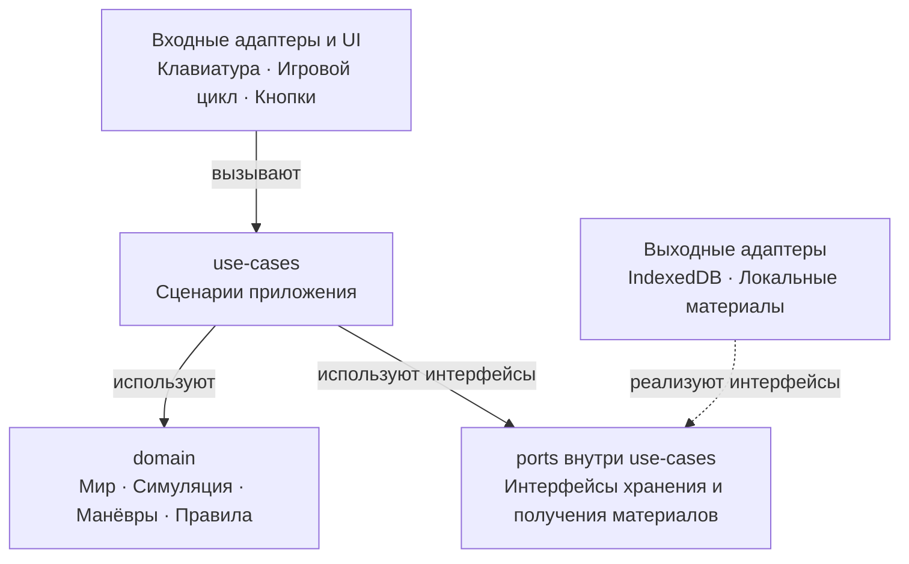
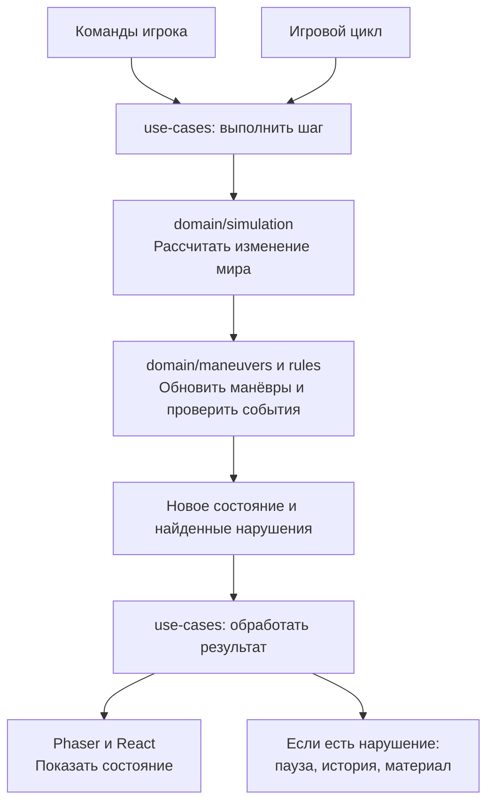

# ПДД — Веб-архитектура v1.0

**Дата:** 9 октября 2026 года.  
**Статус:** первая версия архитектуры по обсуждению; реализация и численные параметры ещё не проверены.  
**Связанное ТЗ в Obsidian:** [[ПДД — ТЗ MVP v1.0]].  
**Исходное ТЗ проекта:** `TZ-PDD-MVP.md` в `/Users/e.alimova/GRK/pdd`.

## 1. Назначение и границы версии

Браузерная игра для изучения ПДД: свободная поездка по городу → обнаружение поддержанного нарушения → объяснение и связанный вопрос из билета → продолжение или повтор ситуации.

**Первую версию делаем без бэкенда.** Симуляция, проверки правил и работа с учебными материалами выполняются в браузере. Карта, вопросы, объяснения и нормативные ссылки поставляются с приложением; история сохраняется на том же устройстве в том же браузере.

Рабочая конфигурация — компьютер, клавиатура, 2D сверху и одна небольшая связная карта. Эти продуктовые решения в ТЗ обозначены как предложения; документ использует их как основу архитектуры.

В MVP входят пять групп проверок:

1. Скорость.
2. Светофор.
3. STOP.
4. Поворотники.
5. Уступание пешеходу.

Автомобильный поток, приоритет между автомобилями, обгон, перестроения, развороты и круговые перекрёстки — дальнейшее расширение. Архитектура предусматривает место для этой логики, но не требует реализовывать её в первой версии.

Мультиплеер, аккаунты, рейтинги и полный экзаменационный режим в эту версию не входят.

## 2. Стек и основные принципы

| Технология | Назначение |
| --- | --- |
| TypeScript | Модель мира, симуляция, проверки ПДД и сценарии приложения |
| React | Меню, приборы, карточки, вопросы, журнал и настройки |
| Phaser | Отображение города, машин, пешеходов, камера и анимации |
| IndexedDB | История поездок, нарушений, ответов и настройки |
| Локальные файлы | Карта, вопросы, объяснения, нормативные ссылки и изображения |

Главные принципы:

- Игра сначала рассчитывает состояние мира, затем интерфейс его показывает. Нарушения не определяются по изображению на экране.
- Дорожная логика не зависит от React, Phaser, браузерных API или хранилища.
- Состояние мира имеет один источник истины — игровую сессию.
- Phaser не запускает независимую физическую модель, изменяющую те же координаты.
- Карта содержит не только изображения, но и дорожный смысл: направления, полосы, ограничения и связи объектов.
- Вопросы и алгоритмы обнаружения нарушений — разные части системы. Новый билет сам по себе не добавляет новую проверку.
- Нарушения, вопросы и попытки ответа учитываются отдельно.
- Возможность продолжить поездку не зависит от правильности ответа, доступности материала или успешности сохранения истории.

## 3. Слои и зависимости



Это схема зависимостей кода. Во время выполнения сценарий вызывает сохранение через порт, но не импортирует конкретную реализацию IndexedDB.

| Часть | Ответственность |
| --- | --- |
| `domain` | Предметная модель, движение и правила дорожного мира, логика обучения |
| `use-cases` | Организация сценариев приложения |
| `adapters` | Конкретные механизмы ввода, запуска, хранения и загрузки |
| `presentation` | Отображение и пользовательский интерфейс |
| `bootstrap` | Создание объектов и соединение всех частей |

Зависимости направлены внутрь:

```text
presentation и входные adapters → use-cases → domain
выходные adapters → интерфейсы ports в use-cases
bootstrap → соединяет конкретные реализации
```

Не создаём интерфейс для каждой функции. Порты нужны на реальных границах с внешними механизмами.

## 4. Domain: сущности, модель мира и логика

Домен — не только описание сущностей. Он содержит данные и правила их изменения и взаимодействия.

| Модуль | Ответственность |
| --- | --- |
| `entities` | Автомобили, пешеходы, светофоры и их состояния |
| `world` | Структура карты, состояние мира, связи дорожных объектов |
| `simulation` | Движение и изменение мира за один шаг |
| `maneuvers` | Начало, ход и завершение манёвров, необходимая история |
| `rules` | Выбор применимых проверок и определение нарушений |
| `violations` | Типы нарушений и подтверждающие обстоятельства |
| `learning` | Соответствие вопроса ситуации, выбор вопроса и оценка ответа |

### 4.1. Постоянная карта

Карта описывает:

- Геометрию дорог, полос, обочин и переходов.
- Направления движения и возможные пути через перекрёстки.
- Знаки, ограничения и области их действия.
- Стоп-линии, их направления и связи со светофорами или STOP.
- Траектории пешеходов.
- Безопасные места старта и возврата.

Не каждый объект должен быть классом. Дорога или обочина могут быть обычными структурами данных.

### 4.2. Изменяемое состояние мира

- Координаты, направление, скорость и поворотники машин.
- Положение и состояние пешеходов.
- Сигналы и фазы светофоров.
- Игровое время и номер шага симуляции.
- Текущие манёвры и состояния проверок.

Автомобиль игрока и будущие компьютерные машины используют общую модель автомобиля. Различается источник команд управления.

Мир шире изображения на экране. Выход за границы камеры сам по себе не останавливает участника движения.

### 4.3. Почему нужна история

По одному состоянию нельзя определить, останавливалась ли машина перед STOP, когда включила указатель и начала ли обгон. Сохраняем необходимую историю действий и состояние текущего манёвра, а не бесконечную запись всех кадров.

### 4.4. Проверки правил

Поддерживаемые проверки находятся в `domain/rules`. Доменная функция наподобие `evaluate-rules` выбирает подходящие проверки по месту, событиям и состоянию манёвров.

Класс автомобиля не содержит все ПДД. Движение, распознавание манёвров и проверка правил — отдельные модули.

## 5. Use-cases: сценарии приложения

Use-case — функция или сервис, выполняющий конкретный сценарий. Это не интерсептор: сценарий не перехватывает произвольные чужие операции, а явно вызывается для задачи приложения.

| Сценарий | Ответственность |
| --- | --- |
| `start-trip` | Создать поездку и начальное состояние мира |
| `step-simulation` | Запустить расчёт следующего состояния, распознавание манёвров и проверки |
| `handle-violation` | Организовать паузу, сохранение и получение материала |
| `pause-trip` / `resume-trip` | Управлять состоянием поездки |
| `answer-question` | Запустить оценку ответа и сохранить попытку |
| `retry-situation` | Восстановить контрольное состояние |
| `return-to-road` | Вернуть машину в безопасное место |
| `finish-trip` | Завершить поездку и подготовить итог |
| `clear-history` | Очистить сохранённую историю |

Домен определяет, нарушено ли правило и почему. Use-case решает, когда вызвать доменную логику и что сделать с результатом.

Домен сам по себе не запускается в фоне. Игровой цикл вызывает `step-simulation`, тот вызывает доменные функции и получает результат.

Сценарий не открывает React-модалку напрямую. Он обновляет состояние приложения — например, текущий разбор нарушения. React отображает это состояние.

### 5.1. Ports

Порты — интерфейсы внешних возможностей, необходимых сценариям. Они принадлежат `use-cases`.

Примеры:

```ts
interface ViolationRepository {
  save(violation: Violation): Promise<void>;
}

interface LearningContentProvider {
  getCandidates(context: ViolationContext): Promise<Question[]>;
}
```

Сценарий знает, что нарушение можно сохранить, но не знает устройство IndexedDB. Поставщик материалов возвращает данные; правила соответствия и приоритет выбора вопроса остаются в `domain/learning`.

Типы и сигнатуры здесь иллюстративные; окончательные контракты определяются при реализации.

## 6. Adapters, presentation и bootstrap

| Каталог | Содержимое |
| --- | --- |
| `adapters/input` | Преобразование клавиатурных событий в команды игры |
| `adapters/runtime` | Запуск игрового цикла и обработка потери фокуса |
| `adapters/persistence` | Реализации хранения через IndexedDB |
| `adapters/content` | Получение локальных учебных материалов |
| `presentation/phaser` | Отображение мира, камера и анимации |
| `presentation/react` | Меню, приборы, карточки, журнал и настройки |
| `presentation/view-models` | Данные, подготовленные для отображения |
| `bootstrap` | Создание сессии, подключение реализаций, запуск и освобождение ресурсов |

Входные адаптеры вызывают сценарии. Выходные адаптеры реализуют порты и выполняют запросы сценариев.

Пример ввода: браузерный `keydown` превращается в команду «газ нажат». Домен не знает о `KeyboardEvent` или конкретной клавише.

Phaser получает координаты из симуляции. Использование собственного физического мира Phaser потребовало бы пересмотра этой границы; в текущем проекте архитектуры он отвечает за отображение.

React получает нужные показатели и события. Весь мир не передаётся через React на каждом шаге.

## 7. Состояние приложения и данные

| Вид состояния | Где находится |
| --- | --- |
| Мир, манёвры и состояния проверок | В памяти игровой сессии |
| Состояние поездки, причины паузы, текущий разбор | Под управлением `use-cases` |
| Локальные детали интерфейса: вкладка, меню | В React |
| История поездок, нарушений, ответов и настройки | В IndexedDB |
| Карта и учебный контент | В локальных файлах приложения |

Структуры мира и правила его изменения определены в домене. Единственной актуальной сессией управляют сценарии. Компоненты не меняют координаты напрямую.

Хардкод данных означает, что проверенные материалы поставляются с приложением. Вопросы и ответы не размазываются по компонентам и условиям проверок.

Материалам нужны стабильные идентификаторы и версии. Изображения хранятся отдельными ресурсами и загружаются по необходимости.

Обновление материалов не должно незаметно менять смысл старой попытки ответа: сохраняем версию и достаточные данные для корректного отображения истории.

## 8. Игровой цикл



Это схема выполнения, а не импортов.

Порядок шага:

1. Получить команды управления.
2. Рассчитать изменение мира за фиксированный интервал.
3. Определить события и обновить состояние манёвров.
4. Выполнить применимые проверки ПДД.
5. Вернуть новое состояние и список нарушений.
6. Обработать результат и передать данные для отображения.

Исходный ориентир — 60 шагов симуляции в секунду. Это техническое предложение, которое проверяется измерениями. Частота отрисовки может отличаться.

У всех участников единое игровое время. Светофоры, пешеходы и машина не используют независимые таймеры, продолжающие работу при паузе.

После зависания вкладки нельзя перемещать машину одним огромным шагом за всё пропущенное время. Ограничиваем догоняющие расчёты; после потери фокуса возвращаемся из паузы без скачка мира.

Запись истории и загрузка материалов не входят в расчёт каждого шага.

## 9. Как определяется нарушение

Каждую поддерживаемую норму вручную переводим в измеримые условия. Игра не читает текст ПДД и не выводит правила автоматически из билетов.

Проверке доступны:

- Карта и связанные дорожные объекты.
- Предыдущее и новое состояние мира.
- События текущего шага.
- История манёвра и состояние предыдущих проверок.

### Пример: проезд на красный

1. Карта содержит стоп-линию, направление проезда и ссылку на управляющий светофор.
2. Симуляция знает положение и размеры машины до и после движения.
3. Геометрическая проверка определяет пересечение передней границей машины соответствующей линии.
4. Проверка правила определяет сигнал в момент пересечения.
5. При запрещающем сигнале возвращается нарушение с обстоятельствами.

Проверяем путь между состояниями: машина не должна проскочить тонкую линию между двумя обновлениями незамеченной.

Пересечение линии — событие мира. Нарушение — результат оценки этого события с учётом условий.

### Выбор проверок

Не запускаем все ПДД для каждого объекта на каждом шаге:

- Скорость проверяем во время движения.
- Подъезд к STOP активирует отслеживание остановки.
- Пересечение стоп-линии запускает относящиеся к ней проверки.
- Поворот активирует проверки указателя.
- Взаимодействие с переходом активирует проверку уступания пешеходу.

При росте карты используем поиск релевантных объектов по расположению и дорожным связям.

## 10. Событие нарушения и его обработка

Нарушение — запись с конкретными обстоятельствами, а не только названием.

```ts
type Violation = {
  id: string;
  tripId: string;
  episodeId: string;
  type: ViolationType;
  simulationTick: number;
  roadObjectId?: string;
  evidence: ViolationEvidence;
  mapVersion: string;
  rulesVersion: string;
  checkpointId?: string;
};
```

`evidence` содержит факты нужного вида: сигнал, скорость, ограничение, сторону манёвра и т. п. Тип нарушения и состав его фактов согласуем через типы TypeScript, например дискриминируемое объединение.

`checkpointId` указывает на контрольное состояние для повтора. Оно может быть недоступно; тогда нельзя обещать точный повтор.

После проверок текущего шага:

1. Объединяем связанные причины в один разбор.
2. Ставим мир на паузу и сбрасываем активный ввод.
3. Добавляем нарушение в историю сессии.
4. Запускаем сохранение в IndexedDB.
5. Получаем локальные материалы и выбираем подходящий вопрос.
6. Передаём интерфейсу обстоятельства, объяснение и вопрос.

Пауза не ждёт окончания записи. Ошибка хранения или получения материала не блокирует продолжение поездки.

Нарушение, вопрос и попытка ответа — разные записи. Правильный ответ не удаляет дорожную ошибку, а неправильный не создаёт новое нарушение.

## 11. Пограничные случаи: геометрия, светофор и STOP

| Ситуация | Требуемое поведение |
| --- | --- |
| Машина перескочила линию между шагами | Проверяем пересечение по пройденному пути |
| Машина рядом с линией на другой полосе | Учитываем геометрию, принадлежность полосе и направление |
| Пересечение совпало со сменой сигнала в одном шаге | Определяем порядок событий и сигнал именно в момент пересечения |
| Разрешённый въезд, завершение после смены сигнала | Само переключение не создаёт нарушение |
| Красный с жёлтым | Запрещающий сигнал |
| Жёлтый | В MVP объяснение без автоматического признания нарушения; ограничение проверки явно указано |
| STOP: остановка после линии | Проезд без необходимой остановки остаётся нарушением |
| STOP: остановка далеко раньше | Не засчитываем её как остановку текущего подъезда |
| STOP: правильная полная остановка | Не требуем выдуманного ожидания в несколько секунд |
| Новый подъезд к тому же STOP | Начинаем новую проверку |
| Задний ход или повторное пересечение | Учитываем направление и контекст; любое касание не считается новым проездом |
| Возврат на дорогу или восстановление повтора | Перенос не считается движением через промежуточные линии |

Численные допуски скорости и положения нужны для устойчивой симуляции. Они не выдаются за дополнительные нормы ПДД. Их значения и геометрия зоны остановки ещё требуют определения и проверки.

## 12. Пограничные случаи: скорость, указатели и эпизоды

| Ситуация | Требуемое поведение |
| --- | --- |
| Непрерывное превышение скорости | Один эпизод, без карточек на каждом шаге |
| Возврат к разрешённой скорости, затем новое превышение | Возможен новый эпизод |
| Колебания около границы из-за погрешности | Стабилизируем определение эпизода; не вводим скрытое разрешённое превышение |
| Изменилось действие знака или ограничения | Пересчитываем применимое ограничение по дорожной модели |
| Нет административного штрафа за некоторое превышение | Не считаем это разрешением превышать скорость |
| Округление скорости на приборе | Отображение и объяснение не должны противоречить фактам проверки |
| Небольшая коррекция руля | Не считается полноценным поворотом |
| Указатель включён, но машина едет прямо | Не признаём манёвр только по поворотнику |
| Нет указателя, неверная сторона или позднее включение | Фиксируем конкретную причину |
| Указатель выключен до завершения манёвра | Устанавливаем нарушение, когда появились достаточные основания |
| Остановка перед поворотом | Не выключает указатель автоматически |
| Поворот завершён | Указатель выключается автоматически |
| Повторное нажатие указателя | Выключает выбранный указатель |
| Включение противоположного указателя | Переключает сторону |
| Одним действием нарушено несколько правил | Связанные причины показываем в одной карточке |

Произвольное число секунд заблаговременности не выдаём за закон. Указатель не даёт преимущества.

Все проверки текущего шага завершаются до показа карточки. Нарушение, основания для которого появились позже, фиксируется позже, а не предсказывается заранее.

После закрытия карточки тот же непрерывный эпизод не должен немедленно создавать новую карточку. Идентификаторы события и эпизода разделяются.

## 13. Пешеходы и будущие сложные ситуации

### 13.1. Пешеход в MVP

Близость пешехода сама по себе не означает нарушение. Нужно установить:

- Имел ли пешеход преимущество.
- Как он намеревался двигаться.
- Вынудила ли машина игрока его изменить скорость или направление.

Поведение пешехода должно сохранять причину реакции, например остановку из-за автомобиля игрока. Но одна причина торможения не заменяет проверку преимущества и всей ситуации.

Пешеход виден заранее и не появляется непосредственно перед машиной без возможности отреагировать. Для MVP используем ограниченный набор проверенных конфигураций переходов.

### 13.2. Приоритет между автомобилями — позже

Для примера «игрок поворачивает налево, встречная машина едет прямо» понадобятся:

1. Определение фактических манёвров; одного указателя недостаточно.
2. Пути участников через перекрёсток и места их пересечения.
3. Правило преимущества для конкретных сигналов, знаков и направлений.
4. Оценка влияния движения игрока на другого участника.

Если встречная машина далеко и не испытала помехи, сам поворот перед ней не означает нарушение. Если она тормозит, нужно определить причину: игрок, другой автомобиль, сигнал или иное условие.

### 13.3. Обгон — позже

Нужно отслеживать последовательность: движение за машиной → выезд на встречную полосу → опережение → возвращение.

Сохраняем, кого обгоняют, место начала, пересечённую разметку, действующие ограничения и ситуацию на встречной полосе. Проверки оценивают разрешённость и безопасность отдельных этапов. Если нарушение установлено в начале, завершения манёвра не ждём.

Столкновение само по себе не является основанием подставлять случайный билет или статью. Объясняем только установленную поддерживаемую причину.

Добавление таких ситуаций потребует новых моделей, проверок и тестов, а не только пополнения базы билетов.

## 14. Пауза, управление и повтор

- Пауза останавливает игровое время, машину, пешеходов и светофоры.
- Открытие карточки и переход в другое окно приостанавливают поездку.
- При потере фокуса и паузе сбрасываем нажатые клавиши: газ не должен остаться зажатым.
- Автоповтор клавиатуры не должен многократно переключать поворотник.
- Закрытие карточки не возобновляет игру, если сохраняется другая причина паузы.
- Продолжение всегда доступно без правильного ответа.

### Повтор ситуации

Для повтора восстанавливаем весь необходимый контекст, а не только позицию машины:

- Игровое время и фазы светофоров.
- Состояние участников движения.
- Манёвры и состояния проверок.
- Состояние генератора случайности, если он используется.

Повтор получает отдельный идентификатор попытки. Старая ошибка и ответы остаются в истории. Журнал не откатывается вместе с миром.

Контрольные состояния хранятся в ограниченном объёме. Момент подходящего снимка должен предшествовать ситуации, чтобы игрок мог изменить действие.

Если точный повтор недоступен или несовместим с текущей версией, явно сообщаем об этом и предлагаем безопасный возврат. Не называем его повтором той же ситуации.

Возврат на дорогу при застревании — отдельный сценарий. После повторного открытия приложения история доступна, а новая поездка начинается с безопасного места.

## 15. Учебный контент и журнал

Вопрос выбирается по существенным обстоятельствам: правилу, знаку, сигналу, манёвру, участникам и виду автомобиля. При нескольких подходящих вариантах сначала выбираем ещё не разобранные, затем вопросы с предыдущими ошибками.

| Ситуация | Поведение |
| --- | --- |
| Карточку закрыли без ответа | Нарушение осталось, вопрос доступен в журнале |
| Правильный ответ | Отдельная правильная попытка, нарушение не отменяется |
| Неправильный ответ | Ошибка ответа без нового дорожного нарушения |
| Ответ после просмотра разбора или подсказки | Попытка с помощью |
| Исправление ответа позже | Новая попытка без перезаписи предыдущей |
| Вопрос про другую ситуацию по тому же правилу | Явная пометка «Другая ситуация по этому правилу» |
| Нет подходящего вопроса | Не подставляем случайный; показываем доступное объяснение и разрешаем продолжить |
| Внешний сайт ПДД недоступен | Локальное объяснение и реквизиты остаются доступны |
| Материалы обновились | История сохраняет привязку к использованной версии |

Отсутствие проверенного материала для поддерживаемой причины — дефект контента, который должен выявляться до выпуска. Ориентир в 10–15 вопросов не важнее полноты покрытия выбранных причин.

Карточка содержит название нарушения, факты поездки, правильное действие, нормативное основание, вопрос, варианты и иллюстрацию при её наличии. Правильный ответ скрыт до ответа или открытия разбора. Нормативная ссылка доступна сразу.

Официальные формулировки, номера, изображения и правильные ответы проверяются по выбранному источнику. Номера не придумываются. Собственные объяснения отделяются от официального вопроса и нормативной цитаты. Для оснований фиксируются реквизиты, ссылка и редакция либо дата проверки; использование материалов должно соответствовать условиям источника.

Точная подборка вопросов и актуальная редакция материалов ещё не выбраны. Эта архитектура не подтверждает юридическую корректность содержимого.

В журнале нарушения и ответы учитываются отдельно. Маленькая подборка не используется для заявления процента готовности ко всему экзамену.

## 16. Хранение и ошибки

Если IndexedDB недоступна или запись завершилась ошибкой:

- Поездка продолжается в памяти.
- Пользователь видит, что история не сохранена.
- Неуспешная запись не обозначается успешной.

Записи имеют стабильные идентификаторы, чтобы повтор сохранения не создавал дубли. Изменения структуры хранилища требуют версии схемы и миграций.

Нарушения и попытки ответа не перезаписывают друг друга. Очистка истории выполняется отдельным пользовательским действием.

Обычная работа не требует API. Однако поставка данных с приложением сама по себе не гарантирует запуск после полного отключения сети: отдельное кеширование приложения для офлайн-запуска не согласовано в этой версии.

## 17. Производительность и развитие

Большой банк вопросов и сложная симуляция создают разную нагрузку.

- Вопросы и изображения загружаются по необходимости; не декодируем все изображения сразу.
- Проверяем релевантные правила и дорожные объекты, а не всю карту на каждом шаге.
- При росте карты применяем пространственный поиск объектов.
- Не обновляем всё дерево React с частотой симуляции.
- Не останавливаем значимого участника только потому, что он за экраном.
- Ограничиваем объём контрольных состояний.
- Измеряем время симуляции, отрисовки и память на целевых устройствах.

При необходимости можно отдельно исследовать вынос расчётов в Web Worker; это не обязательная часть первой версии.

Бэкенд остаётся перспективой. Локальный поставщик контента в будущем может быть заменён HTTP-адаптером при сохранении контракта. Синхронизация прогресса, авторизация и серверная симуляция потребуют отдельных решений: они не появляются автоматически от такой замены.

WebSocket и long polling сейчас не нужны. Перенос проверок на сервер не упрощает правила и добавляет синхронизацию и сетевые задержки. Поэтому текущая версия полностью рассчитывает дорожную ситуацию в браузере.

## 18. Структура проекта

```text
src/
  domain/
    entities/
    world/
    simulation/
    maneuvers/
    rules/
    violations/
    learning/

  use-cases/
    ports/
    session/
    start-trip.ts
    step-simulation.ts
    handle-violation.ts
    pause-trip.ts
    resume-trip.ts
    answer-question.ts
    retry-situation.ts
    return-to-road.ts
    finish-trip.ts
    clear-history.ts

  adapters/
    input/
    runtime/
    persistence/
    content/

  presentation/
    react/
    phaser/
    view-models/

  content/
    maps/
    questions/
    explanations/
    rule-references/

  bootstrap/
```

Это целевая организация ответственности, а не требование заранее создавать пустые папки или абстракции для будущих функций.

## 19. Проверки архитектуры и реализации

| Уровень | Что проверяем |
| --- | --- |
| Домен | Нарушения и похожие правильные действия; переходы между состояниями |
| Use-cases | Последовательность действий, пауза, сохранение, повторы и обработка ошибок |
| Адаптеры | Чтение и запись IndexedDB, загрузка и целостность локальных материалов |
| Интерфейс | Полные сценарии поездки, карточки, журнала и повтора в браузере |
| Границы | Запрет обратных импортов через ESLint |
| Производительность | Время расчёта и отрисовки, память на целевых устройствах |

Для каждой проверки ПДД нужны примеры нарушения и отсутствия нарушения. Особое внимание — сигналу в момент пересечения, повторным проездам, эпизодам превышения, восстановлению мира, отсутствию дублей и причинности реакции пешехода.

Ключевой критерий разделения: дорожной логике можно передать известные состояния и команды и получить результат без React, Phaser, сети и IndexedDB.

## 20. Решения, которые предстоит уточнить

- Геометрия машины, единицы мира и параметры управления.
- Точные клавиши управления.
- Начало и завершение манёвров.
- Допуски остановки и пересечения линий.
- Порядок событий при совпадении пересечения со сменой сигнала.
- Границы непрерывных эпизодов и объединение связанных причин.
- Точные условия уступания пешеходу в поддерживаемых конфигурациях.
- Выбор и срок хранения контрольного состояния для повтора.
- Проверенная подборка вопросов, изображений и нормативных оснований.
- Целевые устройства и показатели производительности.

Первый сквозной сценарий реализации: **подъезд к STOP → остановка или проезд без неё → проверка → карточка → сохранение → повтор**. На нём проверяем связи всех слоёв, затем добавляем остальные правила.

## История версий

| Версия | Дата | Изменения |
| --- | --- | --- |
| 1.0 | 2026-10-09 | Первая версия веб-архитектуры без бэкенда: слои, состояние мира, проверки, локальные материалы, история и обсуждённые пограничные случаи |
