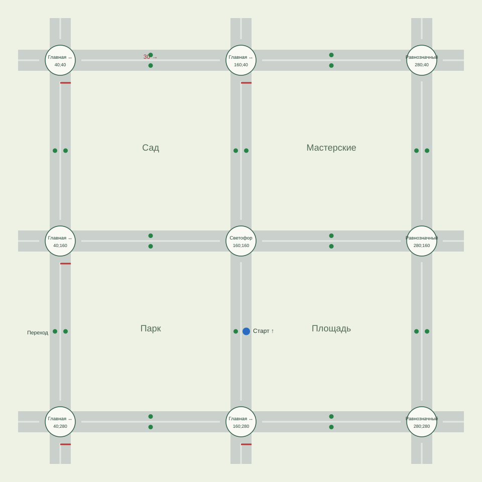

# Схема расширенного города

Подготовлено 18 октября 2026 года для задач #9 и #10. Это данные и проектные артефакты следующей версии. Карта подключена к игровой сцене рабочей ветки; поток и новые проверки ещё не приняты. Текущий опубликованный предпросмотр — `0.2.0-preview.1`.

На схеме четыре квартала: сад, мастерские, парк и площадь. Три горизонтальные и три вертикальные улицы соединяют девять перекрёстков. Можно объехать каждый квартал и вернуться к любому перекрёстку с другой стороны. Короткие внешние продолжения предназначены для появления и удаления потока, а не для новых кварталов.

## Рабочие параметры

Пользователь согласовал четыре квартала, три типа перекрёстков, спокойный поток и плавную камеру. Следующие числа выбраны для первой реализации; удобство ещё нужно проверить в поездке.

| Параметр                    | Первый вариант                             | Причина                                                         |
| --------------------------- | ------------------------------------------ | --------------------------------------------------------------- |
| Город                       | 320 × 320 м                                | Четыре квартала без тесных подходов                             |
| Центры улиц                 | 40, 160, 280 м по обеим осям               | Расстояние между перекрёстками 120 м                            |
| Проезжая часть              | 14 м, по одной полосе 7 м в каждую сторону | Сохраняет пространство для управления текущей машиной           |
| Зона путей перекрёстка      | 28 × 28 м                                  | Правый поворот радиусом 10.5 м, левый — 17.5 м                  |
| Прямой участок между зонами | 92 м                                       | Место для распознавания знака, торможения и включения указателя |
| Поток                       | Начать с 6 машин, предел 8                 | Рабочее предложение, проверка очередей в #12 и #6               |
| Попытка появления           | Не чаще одного раза в 6 секунд             | Только в свободной внешней полосе за областью обзора            |
| Обзор                       | Около 120 × 100 м                          | Видимость подхода, а не вся карта мелким масштабом              |
| Следование камеры           | Сглаживание порядка 0.2 с                  | Настроить по фактической поездке в #11                          |

Габариты доменной машины остаются 4.2 × 1.8 м. Увеличение синего изображения на 10% не меняет расчётную геометрию.

## Перекрёстки и дорожные объекты

| Место                                         | Управление                     | Условия                                                                                                         |
| --------------------------------------------- | ------------------------------ | --------------------------------------------------------------------------------------------------------------- |
| Центр, 160;160                                | Основные светофоры, без секций | Встречные подходы получают зелёный одновременно; поперечные разделены фазами и промежутком со всеми красными    |
| Все перекрёстки на x=40 и x=160, кроме центра | Прямая главная запад–восток    | На севере «Уступите дорогу», на юге STOP; главная не меняет направление                                         |
| Все перекрёстки на x=280                      | Равнозначные                   | Нет светофора и знаков приоритета                                                                               |
| Верхняя улица, от x=68 до x=146               | Знак 30, только на восток      | После зоны подхода возвращается общий городской лимит 60                                                        |
| Западная улица, y=220                         | Нерегулируемый переход         | Пешеход пересекает обе полосы; подробная проверка двустороннего взаимодействия в #12 и #4                       |
| Южный край центрального перекрёстка, y=172    | Регулируемый переход П1        | Пешеход начинает на свой зелёный и заканчивает после смены сигнала; поворот и начало движения проверяются в #15 |

На всех прямых отрезках между зонами перекрёстков встречные полосы разделены сплошной линией. Внутри перекрёстков её нет: разрешённый левый поворот не считается запрещённым выездом. Основание запрета движения по встречной на обозначенных участках — п. 9.1.1 и соответствующая разметка; текст пункта 9.1(1) (в данных обозначен как 9.1.1) сверён 18 октября 2026 года. Покрытие игровых объяснений относится к #1.

Зелёные точки — 24 кандидата для безопасного возврата, по центру внутренних полос. Синяя точка — старт на север по центральной улице. Само наличие точки в данных не гарантирует свободное место: сценарий возврата обязан проверить машины и их приближение перед размещением игрока (#13).

## Разрешённые движения и все пары путей

Каждый перекрёсток имеет четыре подхода и 12 соединений: с каждого подхода прямо, налево и направо. Развороты не включены. Название стороны показывает, **откуда** приехала машина: `north` — с севера, а не движение на север.

[Полная таблица пар](conflicts.csv) содержит 1296 строк: 9 перекрёстков × 12 движений × 12 движений. В неё включены оба порядка участников и движения с одного подхода. Таблица создаётся из тех же данных, что будут использованы симуляцией.

| Значение `yields` | Значение                                                                                           |
| ----------------- | -------------------------------------------------------------------------------------------------- |
| `first`, `second` | Первый или второй участник обязан уступить при подтверждённом конфликте                            |
| `neither`         | Пути совместимы, присутствие другого участника не требует ожидания                                 |
| `queue`           | Машины с одного подхода: дистанция и порядок движения, без подмены правила приоритета              |
| `signals`         | Поперечные пути регулируемого перекрёстка: нужны фаза и факт завершения ранее разрешённого проезда |

Столбец `conflict` учитывает ширину машин и запас 0.4 м, а не только пересечение осевых линий. Этот запас технический, не норма ПДД. Таблица не определяет нарушение сама по себе: нужны одновременное приближение, применимая обязанность уступить и доказанная реакция на действие игрока. Дальний участник и торможение перед красным не доказывают помеху.

| Условие                                                                    | Применимое правило                         |
| -------------------------------------------------------------------------- | ------------------------------------------ |
| Основной зелёный, левый поворот перед встречным прямо/направо              | 13.4                                       |
| Новый разрешающий сигнал, другой участник заканчивает ранее начатый проезд | 13.8                                       |
| Второстепенная перед главной                                               | 13.9                                       |
| Равнозначные дороги, участник справа                                       | 13.11                                      |
| Равнозначные по приоритету встречные дороги, левый поворот                 | 13.12                                      |
| Поворот через путь пешехода                                                | 13.1, отдельная проверка движения пешехода |

Для работающего светофора правило «справа» не используется. Сигналы оцениваются в момент въезда; разрешённый въезд не становится нарушением при смене фазы. Жёлтый остаётся без автоматической оценки нарушения. Столкновение не определяет виновного автоматически.

Ссылки для сверки: [проезд перекрёстков](https://www.consultant.ru/document/cons_doc_LAW_2709/74cbe820904f4f8ce76047ddbd81d14c8b953d3e/), [знаки приоритета](https://www.consultant.ru/document/cons_doc_LAW_2709/f813c443e749db7b760a9fb7729a4e4ccdb2f3ea/). Повторный запрос 18 октября 2026 года успешен. Сверены пункты 13.1–13.12, 9.1(1), 9.10 и знаки 2.1, 2.4, 2.5 в редакции от 28.08.2026. Для двух второстепенных подходов применяется 13.10 вместе с правилами равнозначных дорог. При завершении разрешённого проезда учитываются 13.7 и 13.8; статическая таблица не заменяет проверку сигнала при въезде. Таблица охватывает безрельсовые машины и три поддерживаемых направления; трамваи, круговое движение, дополнительные секции и меняющая направление главная дорога исключены из этой карты. Нормативная часть схемы проверена; реализация и приёмка отдельных детекторов выполняются в их задачах.

## Проверки и воспроизведение

`tests/unit/road-network.test.ts` проверяет загрузку обеих карт, 108 соединений, все упорядоченные пары, симметрию решений, отсутствие противоречий, совместимость встречных прямых и левых поворотов, дорожный контекст по габаритам и пересечение нескольких полос между состояниями.

Валидация отклоняет повторные ID, отсутствующие ссылки, неверные направления, вырожденные пути, несовместимые соединения, пропущенные движения, небезопасные статические позиции и несвязные внутренние маршруты. Геометрическая связность не заменяет браузерную проверку удобства управления.

Обновить схему и таблицы: `npm run city:plan`. Проверить, что артефакты соответствуют данным: `npm run city:plan -- --check`.
